<!-- README.md is generated from README.Rmd. Please edit that file -->

# `{statsExpressions}`: Tidy dataframes and expressions with statistical details

[](https://CRAN.R-project.org/package=statsExpressions)
[](https://lifecycle.r-lib.org/articles/stages.html)
[](https://doi.org/10.21105/joss.03236)

# Introduction 

The `{statsExpressions}` package has two key aims:

- to provide a consistent syntax to do statistical analysis with tidy
  data (in pipe-friendly manner),
- to provide statistical expressions (pre-formatted in-text statistical
  results) for plotting functions.

Statistical packages exhibit substantial diversity in terms of their
syntax and expected input type. This can make it difficult to switch
from one statistical approach to another. For example, some functions
expect vectors as inputs, while others expect dataframes. Depending on
whether it is a repeated measures design or not, different functions
might expect data to be in wide or long format. Some functions can
internally omit missing values, while other functions error in their
presence. Furthermore, if someone wishes to utilize the objects returned
by these packages downstream in their workflow, this is not
straightforward either because even functions from the same package can
return a list, a matrix, an array, a dataframe, etc., depending on the
function.

This is where `{statsExpressions}` comes in: It can be thought of as a
unified portal through which most of the functionality in these
underlying packages can be accessed, with a simpler interface and no
requirement to change data format.

This package forms the statistical processing backend for
[`ggstatsplot`](https://www.indrapatil.com/ggstatsplot/) package.

For more documentation, see the dedicated
[website](https://www.indrapatil.com/statsExpressions/).

# Installation

Note: This package supports R-devel, the current R release, and the
previous R release.

| Type        | Command                                       |
|:------------|:----------------------------------------------|
| Release     | `install.packages("statsExpressions")`        |
| Development | `pak::pak("IndrajeetPatil/statsExpressions")` |

On Linux, `{statsExpressions}` installation may require additional
system dependencies, which can be checked using:

``` r
pak::pkg_sysreqs("statsExpressions")
```

# Citation

The package can be cited as:

``` r
citation("statsExpressions")
To cite package 'statsExpressions' in publications use:

  Patil, I., (2021). statsExpressions: R Package for Tidy Dataframes
  and Expressions with Statistical Details. Journal of Open Source
  Software, 6(61), 3236, https://doi.org/10.21105/joss.03236

A BibTeX entry for LaTeX users is

  @Article{,
    doi = {10.21105/joss.03236},
    year = {2021},
    publisher = {{The Open Journal}},
    volume = {6},
    number = {61},
    pages = {3236},
    author = {Indrajeet Patil},
    title = {{statsExpressions: {R} Package for Tidy Dataframes and Expressions with Statistical Details}},
    journal = {{Journal of Open Source Software}},
  }
```

# General workflow


# Summary of functionality

| Function | Analysis | Parametric | Non-parametric | Robust | Bayesian |
|:---|:---|:---|:---|:---|:---|
| `one_sample_test()` | one-sample test | ✅ | ✅ | ✅ | ✅ |
| `two_sample_test()` | two-sample test | ✅ | ✅ | ✅ | ✅ |
| `oneway_anova()` | one-way ANOVA | ✅ | ✅ | ✅ | ✅ |
| `corr_test()` | correlation | ✅ | ✅ | ✅ | ✅ |
| `contingency_table()` | one- or two-way contingency table | ✅ | ✅ | ❌ | ✅ |
| `meta_analysis()` | random-effects meta-analysis | ✅ | ❌ | ✅ | ✅ |
| `pairwise_comparisons()` | pairwise group comparisons | ✅ | ✅ | ✅ | ✅ |
| `centrality_description()` | centrality and distribution | ✅ | ✅ | ✅ | ✅ |

❌ means that no dedicated analysis of that type exists. For contingency
tables, `type = "nonparametric"` and `type = "robust"` both use the same
frequentist tests as `type = "parametric"`.

`pairwise_contingency_table()` provides pairwise Fisher’s exact tests
with Cramer’s *V* effect sizes. It does not have a `type` argument.

# Tidy dataframes from statistical analysis

To illustrate the simplicity of this syntax, let’s say we want to run a
one-way ANOVA. If we first run a non-parametric ANOVA and then decide to
run a robust ANOVA instead, the syntax remains the same and the
statistical approach can be modified by changing a single argument:

``` r
mtcars |> oneway_anova(cyl, wt, type = "nonparametric")
#> # A tibble: 1 × 15
#>   parameter1 parameter2 statistic df.error   p.value
#>   <chr>      <chr>          <dbl>    <int>     <dbl>
#> 1 wt         cyl             22.8        2 0.0000112
#>   method                       effectsize      estimate conf.level conf.low
#>   <chr>                        <chr>              <dbl>      <dbl>    <dbl>
#> 1 Kruskal-Wallis rank sum test Epsilon2 (rank)    0.736       0.95    0.624
#>   conf.high conf.method          conf.iterations n.obs expression
#>       <dbl> <chr>                          <int> <int> <list>    
#> 1         1 percentile bootstrap             100    32 <language>

mtcars |> oneway_anova(cyl, wt, type = "robust")
#> # A tibble: 1 × 12
#>   statistic    df df.error p.value
#>       <dbl> <dbl>    <dbl>   <dbl>
#> 1      12.7     2     12.2 0.00102
#>   method                                           
#>   <chr>                                            
#> 1 A heteroscedastic one-way ANOVA for trimmed means
#>   effectsize                         estimate conf.level conf.low conf.high
#>   <chr>                                 <dbl>      <dbl>    <dbl>     <dbl>
#> 1 Explanatory measure of effect size     1.05       0.95    0.843      1.50
#>   n.obs expression
#>   <int> <list>    
#> 1    32 <language>
```

For worked examples of these data frames, see [Data frame
outputs](https://www.indrapatil.com/statsExpressions/articles/web_only/dataframe_outputs.html);
for their columns and attributes, see [Return value
schema](https://www.indrapatil.com/statsExpressions/articles/web_only/return_value_schema.html).

The data frames also work with `knitr::kable()` to generate a table:

``` r
set.seed(123)

# one-sample robust t-test
# we will leave `expression` column out; it's not needed for using only the dataframe
mtcars |>
  one_sample_test(wt, test.value = 3, type = "robust") |>
  dplyr::select(-expression) |>
  knitr::kable()
```

| statistic | p.value | n.obs | method | effectsize | estimate | conf.level | conf.low | conf.high |
|---:|---:|---:|:---|:---|---:|---:|---:|---:|
| 1.179181 | 0.275 | 32 | Bootstrap-t method for one-sample test | Trimmed mean | 3.197 | 0.95 | 2.854246 | 3.539754 |

These functions are also compatible with other popular data manipulation
packages.

For example, let’s say we want to run a one-sample *t*-test for all
levels of a certain grouping variable. We can use `dplyr` to do so:

``` r
# for reproducibility
set.seed(123)
library(dplyr)

# grouped operation
# running one-sample test for all levels of grouping variable `cyl`
mtcars |>
  group_by(cyl) |>
  group_modify(~ one_sample_test(.x, wt, test.value = 3), .keep = TRUE) |>
  ungroup()
#> # A tibble: 3 × 16
#>     cyl    mu statistic df.error  p.value method            alternative
#>   <dbl> <dbl>     <dbl>    <dbl>    <dbl> <chr>             <chr>      
#> 1     4     3    -4.16        10 0.00195  One Sample t-test two.sided  
#> 2     6     3     0.870        6 0.418    One Sample t-test two.sided  
#> 3     8     3     4.92        13 0.000278 One Sample t-test two.sided  
#>   effectsize estimate conf.level conf.low conf.high conf.method
#>   <chr>         <dbl>      <dbl>    <dbl>     <dbl> <chr>      
#> 1 Hedges' g    -1.16        0.95   -1.88     -0.402 ncp        
#> 2 Hedges' g     0.286       0.95   -0.388     0.937 ncp        
#> 3 Hedges' g     1.24        0.95    0.544     1.91  ncp        
#>   conf.distribution n.obs expression
#>   <chr>             <int> <list>    
#> 1 t                    11 <language>
#> 2 t                     7 <language>
#> 3 t                    14 <language>
```

# Using expressions in custom plots

Note that *expression* here means **a pre-formatted in-text statistical
result**. In addition to other details contained in the dataframe, there
is also a column titled `expression`, which contains expression with
statistical details and can be displayed in a plot.

For **all** statistical test expressions, the default template attempts
to follow the gold standard for statistical reporting.

For example, here are results from Welch’s *t*-test:

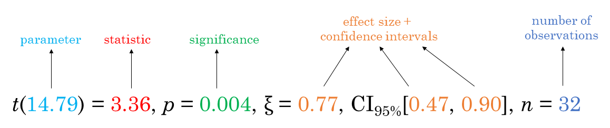

To display a single result in a plot, you have two options:

- extract the expression from the list column
  (`results_data$expression[[1]]`) without parsing
- use the list column as is, in which case you will need to parse it
  (`parse(text = results_data$expression)`)

For several row-specific labels in a geometric layer, map `expression`
to `label` and use `parse = TRUE`, as in the centrality example below.

Here are a few examples for supported analyses. Let’s load the needed
library for visualization:

``` r
library(ggplot2)
```

## Expressions for centrality measure

``` r
# displaying mean for each level of `cyl`
centrality_description(mtcars, cyl, wt) |>
  ggplot(aes(cyl, wt)) +
  geom_point() +
  geom_label(aes(label = expression), parse = TRUE)
```

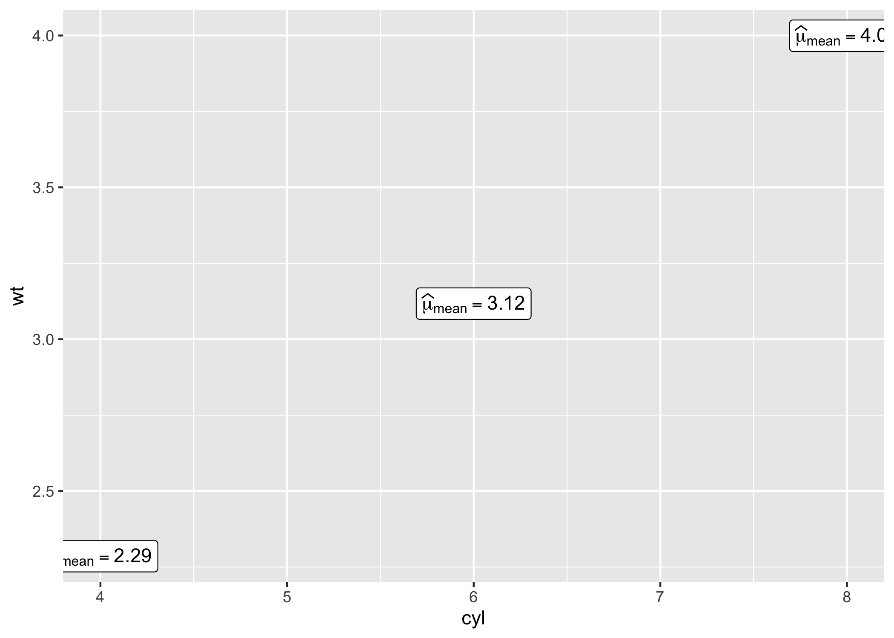

## Expressions for one-way ANOVAs

### Between-subjects design

``` r
set.seed(123)
library(ggridges)

results_data <- oneway_anova(iris, Species, Sepal.Length, type = "robust")

# create a ridgeplot
ggplot(iris, aes(x = Sepal.Length, y = Species)) +
  geom_density_ridges() +
  labs(
    title = "A heteroscedastic one-way ANOVA for trimmed means",
    subtitle = results_data$expression[[1]]
  )
```

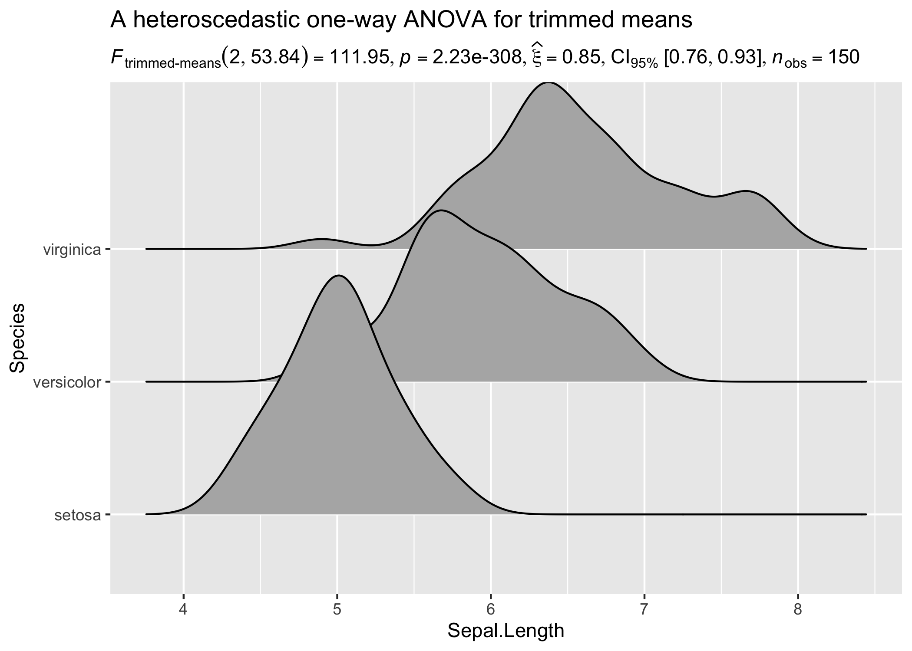

### Within-subjects design

``` r
set.seed(123)
library(WRS2)
library(ggbeeswarm)

results_data <- oneway_anova(
  WineTasting,
  Wine,
  Taste,
  paired = TRUE,
  subject.id = Taster,
  type = "np"
)

ggplot(WineTasting, aes(Wine, Taste, color = Wine)) +
  geom_quasirandom() +
  labs(
    title = "Friedman's rank sum test",
    subtitle = parse(text = results_data$expression)
  )
```

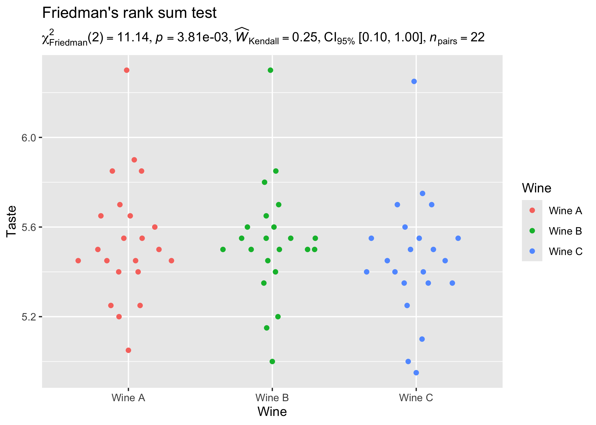

## Expressions for two-sample tests

### Between-subjects design

``` r
set.seed(123)

results_data <- two_sample_test(ToothGrowth, supp, len)

ggplot(ToothGrowth, aes(supp, len)) +
  geom_boxplot() +
  labs(
    title = "Two-Sample Welch's t-test",
    subtitle = parse(text = results_data$expression)
  )
```

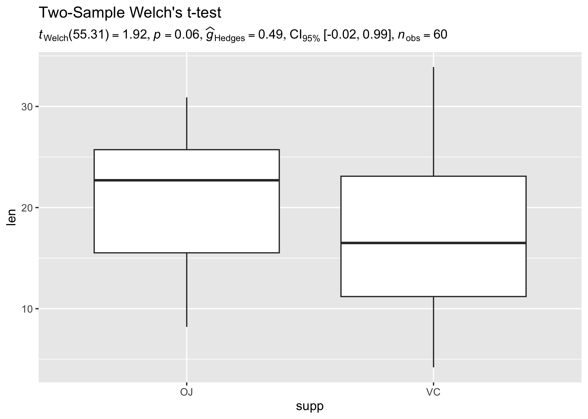

### Within-subjects design

``` r
set.seed(123)
library(tidyr)
library(PairedData)
data(PrisonStress)

# get data in tidy format
df <- pivot_longer(PrisonStress, starts_with("PSS"), names_to = "PSS", values_to = "stress")

results_data <- two_sample_test(
  data = df,
  x = PSS,
  y = stress,
  paired = TRUE,
  subject.id = Subject,
  type = "np"
)

# plot
suppressWarnings(paired.plotProfiles(
  PrisonStress, "PSSbefore", "PSSafter",
  subjects = "Subject"
)) +
  labs(
    title = "Two-sample Wilcoxon paired test",
    subtitle = parse(text = results_data$expression)
  )
```

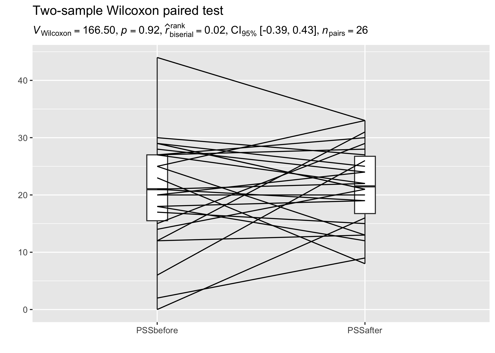

## Expressions for one-sample tests

``` r
set.seed(123)

# dataframe with results
results_data <- one_sample_test(mtcars, wt, test.value = 3, type = "bayes")

# creating a histogram plot
ggplot(mtcars, aes(wt)) +
  geom_histogram(alpha = 0.5) +
  geom_vline(xintercept = mean(mtcars$wt), color = "red") +
  labs(subtitle = parse(text = results_data$expression))
```

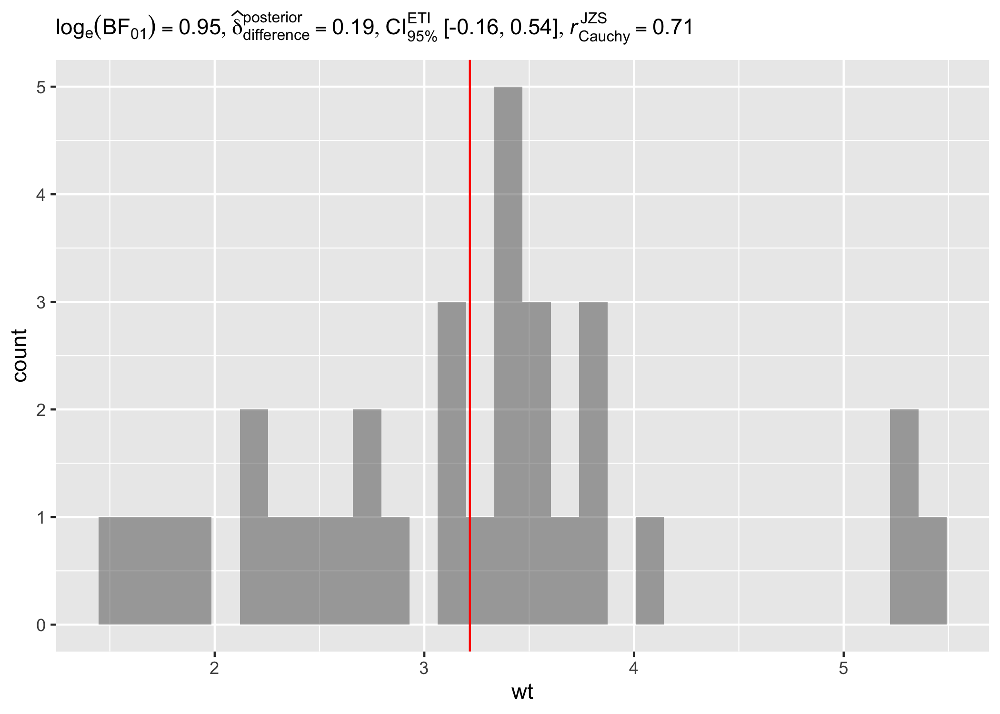

## Expressions for correlation analysis

Let’s look at another example where we want to run correlation analysis:

``` r
set.seed(123)

# dataframe with results
results_data <- corr_test(mtcars, mpg, wt, type = "nonparametric")

# create a scatter plot
ggplot(mtcars, aes(mpg, wt)) +
  geom_point() +
  geom_smooth(method = "lm", formula = y ~ x) +
  labs(
    title = "Spearman's rank correlation coefficient",
    subtitle = parse(text = results_data$expression)
  )
```

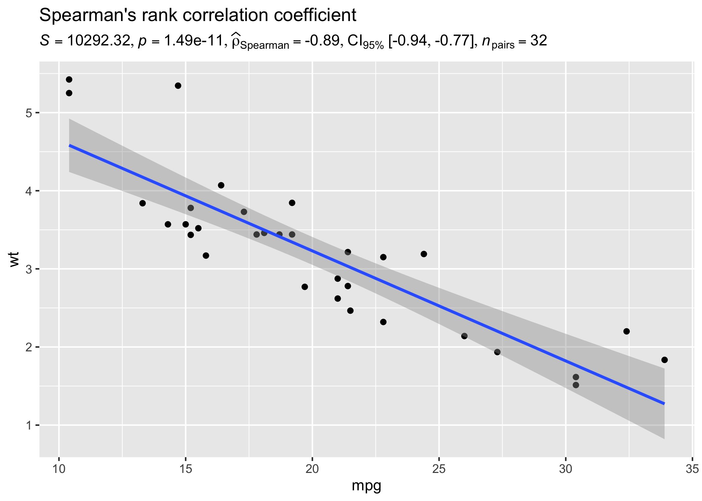

## Expressions for contingency table analysis

For categorical/nominal data - one-sample:

``` r
set.seed(123)

# dataframe with results
results_data <- contingency_table(
  as.data.frame(table(mpg$class)),
  Var1,
  counts = Freq,
  type = "bayes"
)

# create a pie chart
ggplot(as.data.frame(table(mpg$class)), aes(x = "", y = Freq, fill = factor(Var1))) +
  geom_bar(width = 1, stat = "identity") +
  theme(axis.line = element_blank()) +
  # cleaning up the chart and adding results from one-sample proportion test
  coord_polar(theta = "y", start = 0) +
  labs(
    fill = "Class",
    x = NULL,
    y = NULL,
    title = "Pie Chart of class (type of car)",
    caption = parse(text = results_data$expression)
  )
```

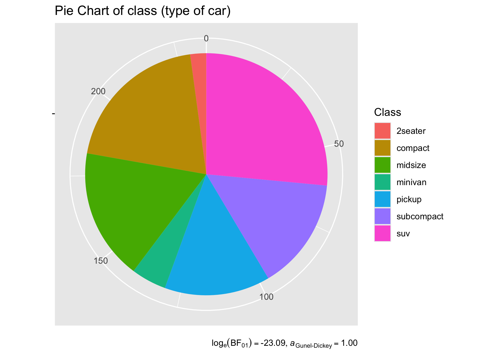

You can also use these functions to get the expression in return without
having to display them in plots:

``` r
set.seed(123)

# Pearson's chi-squared test of independence
contingency_table(mtcars, am, vs)$expression[[1]]
#> list(chi["Pearson"]^2 * "(" * 1 * ")" == "0.91", italic(p) == 
#>     "0.34", widehat(italic("V"))["Cramer"] == "0.00", CI["95%"] ~ 
#>     "[" * "0.00", "0.49" * "]", italic("n")["obs"] == "32")
```

## Expressions for meta-analysis

``` r
set.seed(123)
library(metaviz)

# dataframe with results
results_data <- meta_analysis(dplyr::rename(mozart, estimate = d, std.error = se))

# meta-analysis forest plot with results random-effects meta-analysis
suppressWarnings(viz_forest(
  x = mozart[, c("d", "se")],
  study_labels = mozart[, "study_name"],
  xlab = "Cohen's d",
  variant = "thick",
  type = "cumulative"
)) +
  labs(
    title = "Meta-analysis of Pietschnig, Voracek, and Formann (2010) on the Mozart effect",
    subtitle = parse(text = results_data$expression)
  ) +
  theme(text = element_text(size = 12))
```

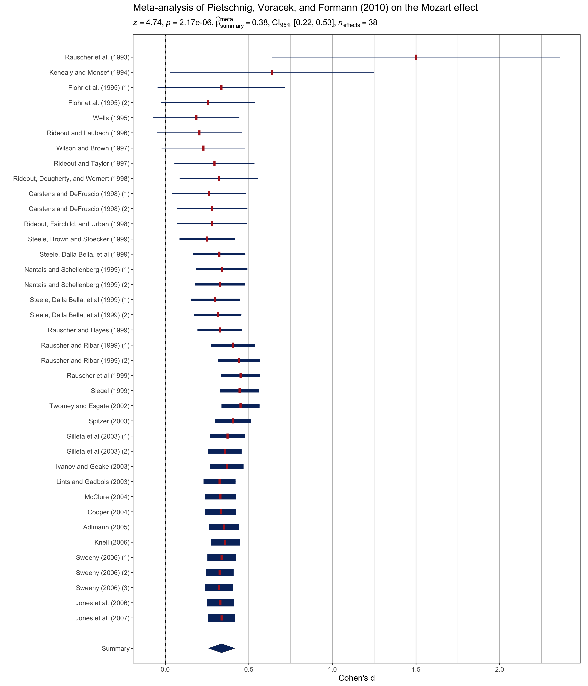

# Customizing details to your liking

Sometimes you may not wish to include so many details in the subtitle.
In that case, you can extract the expression and copy-paste only the
part you wish to include. For example, here only statistic and
*p*-values are included:

``` r
set.seed(123)

# extracting detailed expression
(res_expr <- oneway_anova(iris, Species, Sepal.Length, var.equal = TRUE)$expression[[1]])
#> list(italic("F")["Fisher"](2, 147) == "119.26", italic(p) == 
#>     "1.67e-31", widehat(omega["p"]^2) == "0.61", CI["95%"] ~ 
#>     "[" * "0.53", "1.00" * "]", italic("n")["obs"] == "150")

# adapting the details to your liking
ggplot(iris, aes(x = Species, y = Sepal.Length)) +
  geom_boxplot() +
  labs(subtitle = ggplot2::expr(paste(
    NULL, italic("F"), "(", "2", ",", "147", ") = ", "119.26", ", ",
    italic("p"), " = ", "1.67e-31"
  )))
```

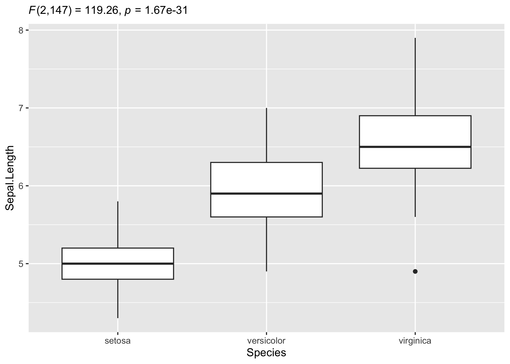

# Tests and effect sizes

See [Test and effect size
details](https://www.indrapatil.com/statsExpressions/articles/stats_details.html)
for the methods, effect sizes, and underlying functions used by each
analysis. The same method tables are included in the individual function
help pages.

# Usage in `{ggstatsplot}`

Note that these functions were initially written to display results from
statistical tests on ready-made `{ggplot2}` plots implemented in
`{ggstatsplot}`.

For detailed documentation, see the package website:
<https://www.indrapatil.com/ggstatsplot/>

Here is an example from `{ggstatsplot}` of what the plots look like when
the expressions are displayed in the subtitle:

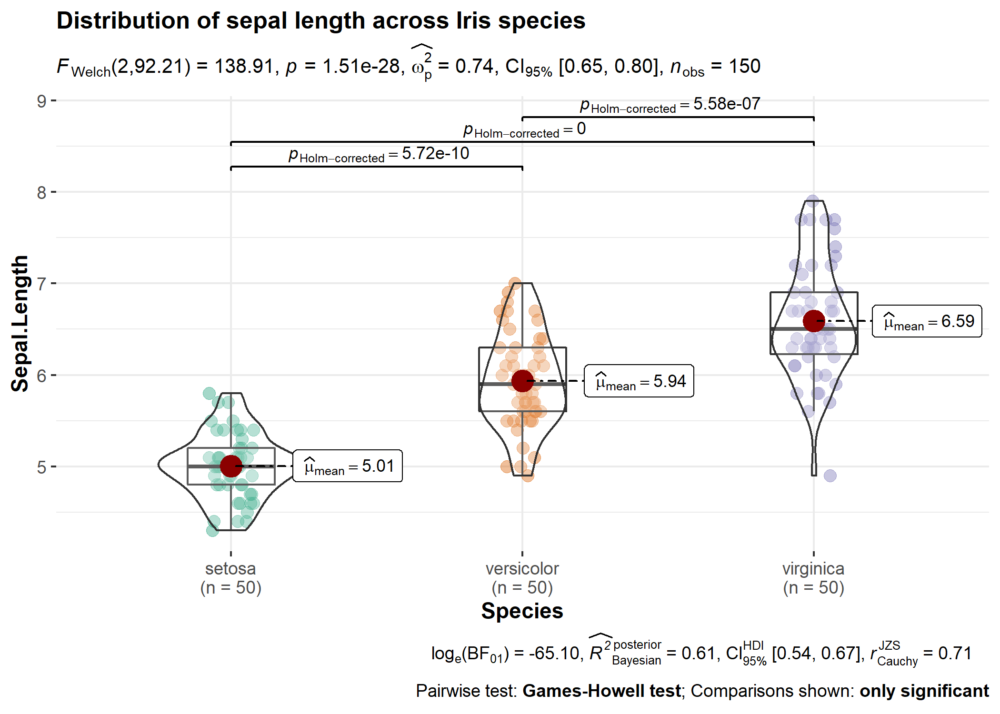

# Acknowledgments

The hexsticker and the schematic illustration of general workflow were
generously designed by Sarah Otterstetter (Max Planck Institute for
Human Development, Berlin).
